Лабораторна робота № 4
Дисципліна: «Високопродуктивні розподілені обчислювальні системи» Тема: «Синхронізація пула воркерів »

КПІ ім. Ігоря Сікорського, факультет біомедичної інженерії, кафедра біомедичної кібернетики

Виконала: студентка гр. ЗК-61мп Бойко Я. Л. Перевірив: старший викладач БМК Матвійчук О. В.

Київ, 2026

## Завдання для варіанта №4

| Параметр | Значення |
|---|---|
| **q_lo / q_hi** | 0,02 / 0,98 |
| **T_poll, мс** | 100 |
| **L, с** | 10 |
| **Сценарій відмови – Ф2** | завершити сесію бази одного воркера командою `SELECT pg_terminate_backend(pid)` під час кроку обробки.<br>Що записати: рядки журналу воркера про перепідключення; доля задачі, що оброблялась; кількість результатів для неї |
| **Додаткова вимога – Д6** | скасування задачі: `DELETE /tasks/{id}` переводить queued у cancelled, а для running виставляє прапорець, який воркер перевіряє між проходами k.<br>Що записати: час від запиту скасування до зупинки обробки для 20 задач у running: p50 і p99; статус і кількість результатів скасованих задач |

## Хід роботи

## Крок 1. Таблиці черги задач, ендпоінти задач і метрики черги

### 1.1. Схема бази

Схему доповнено у файлі db/schema.sql. Таблиця tasks є самою чергою (один рядок – одна задача обробки запису з lab_results); task_results зберігає результати окремо, щоб стан задачі й результат не змішувалися, а повторний запис результату можна було заблокувати первинним ключем.

Таблиця 1 – Поля таблиці tasks

| Поле                                | Тип і обмеження                                       | Призначення                                                                   |
|-------------------------------------|-------------------------------------------------------|-------------------------------------------------------------------------------|
| id                                  | BIGINT IDENTITY, PK                                   | номер задачі, видає база                                                      |
| record_id                           | BIGINT NOT NULL, FK на lab_results, ON DELETE CASCADE | запис для обробки; каскад потрібен, щоб DELETE /lab-results/{id} не давав 500 |
| status                              | VARCHAR(10) NOT NULL DEFAULT 'queued', CHECK          | queued, running, done або failed                                              |
| seed                                | BIGINT NOT NULL                                       | початкове значення генератора зрізу (1 … 2^31 − 1)                            |
| attempts, max_attempts              | INT NOT NULL, 0 і 3                                   | кількість захоплень і їхня межа                                               |
| token                               | BIGINT NOT NULL DEFAULT 0                             | fencing token, +1 під час кожного захоплення                                  |
| lease_until, worker_id              | TIMESTAMPTZ, VARCHAR(64)                              | до якого часу і ким задача зайнята                                            |
| created_at, started_at, finished_at | TIMESTAMPTZ                                           | моменти створення, останнього захоплення і завершення                         |

Таблиця task_results зберігає результати виконання задач. Поле task_id одночасно є первинним і зовнішнім ключем на tasks(id), що забезпечує зв'язок результату з відповідною задачею та гарантує збереження не більше одного результату для кожної задачі. Індекс idx_tasks_status_created (status, created_at) прискорює пошук найстарішої задачі зі статусом queued без повного перегляду таблиці та сортування.

Міграція. Job db-migrate чекає готовності PostgreSQL (pg_isready) і застосовує schema.sql. Команди IF NOT EXISTS забезпечують безпечний повторний запуск. У deploy.ps1 додано видалення попереднього Job перед apply та перезапуск deployment/web, оскільки тег образу не змінюється.

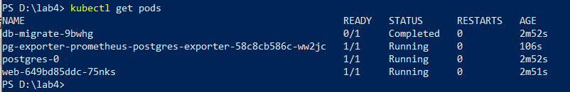

*Рисунок 1 – Стан подів після розгортання: db-migrate – Completed, postgres-0, web, pg-exporter – Running.*

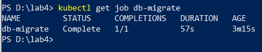

*Рисунок 2 – Job міграції: Complete 1/1, 57 с (спершу чекав готовності бази).*

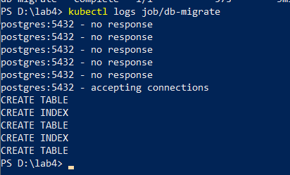

*Рисунок 3 – Журнал Job: після «accepting connections» виконано п'ять команд CREATE (lab_results, індекс, tasks, індекс, task_results), помилок немає.*

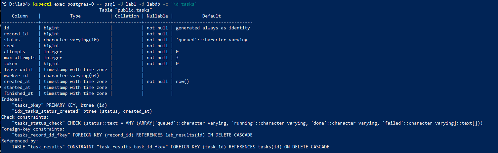

*Рисунок 4 – Структура tasks (\d tasks): 12 полів зі значеннями за замовчуванням, PK, індекс idx_tasks_status_created, CHECK на status, FK з каскадом.*

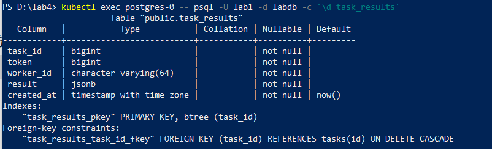

*Рисунок 5 – Структура task_results (\d task_results): task_id – PK і FK на tasks, result типу jsonb.*

### 1.2. Ендпоінти задач

Таблиця 2 – Ендпоінти задач

| Метод і шлях                 | Призначення                                                      | Коди                        |
|------------------------------|------------------------------------------------------------------|-----------------------------|
| POST /lab-results/{id}/tasks | створити задачу обробки запису; у відповіді тіло задачі          | 202; 404, якщо запису немає |
| GET /tasks/{id}              | стан задачі з результатом (result, null, якщо його ще немає)     | 200; 404                    |
| GET /tasks                   | перелік; фільтр status, limit (за замовч. 20, макс. 100), offset | 200; 400                    |

Поле seed генерується сервісом випадково. Задача створюється через INSERT ... SELECT: якщо запису немає, повертається 404 без окремої перевірки. GET /tasks/{id} використовує LEFT JOIN із task_results. Некоректний status у запиті повертає 400 із зазначенням поля.

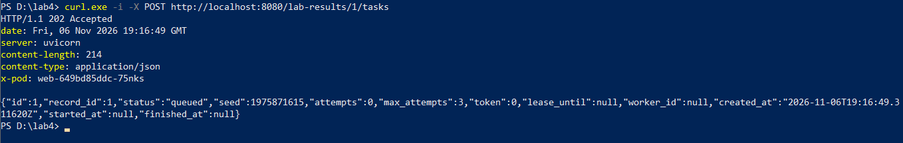

*Рисунок 6 – POST /lab-results/1/tasks → 202: id видала база, seed згенерував сервіс, status = queued, attempts = 0, token = 0.*

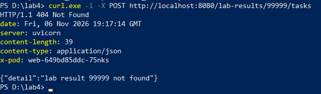

*Рисунок 7 – POST для неіснуючого запису (id 99999) → 404, задачу не створено.*

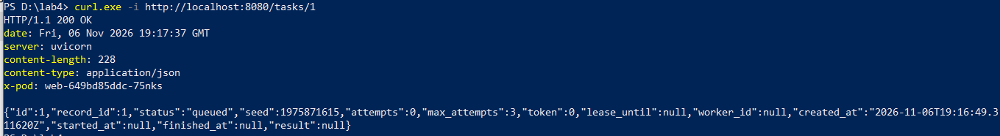

*Рисунок 8 – GET /tasks/1 → 200; result = null, бо воркерів ще немає.*

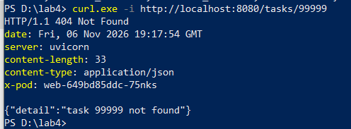

*Рисунок 9 – GET /tasks/99999 → 404.*

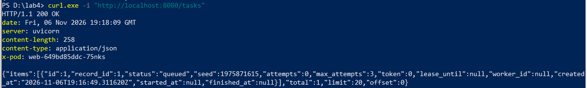

*Рисунок 10 – GET /tasks → 200: відповідь – обʼєкт (items, total = 1, limit = 20 за замовчуванням, offset = 0).*

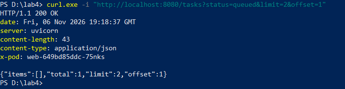

*Рисунок 11 – GET /tasks?status=queued&limit=2&offset=1 → 200: offset = 1 пропускає єдину задачу, тому items порожній, а total = 1.*

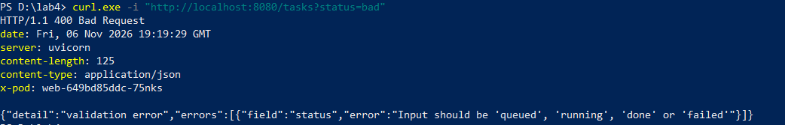

*Рисунок 12 – GET /tasks?status=bad → 400 з назвою поля status.*

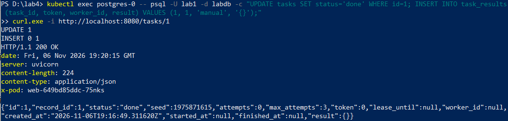

*Рисунок 13 – Перевірка поля result: воркерів ще немає, тому результат вставлено вручну (UPDATE + INSERT INTO task_results ... '{}'); GET /tasks/1 повертає status = done і result = {}. Тестові дані потім видалено.*

### 1.3. Метрики черги

До /metrics додано метрики tasks_queued і tasks_running. Фоновий потік оновлює їх кожні 5 с одним SQL-запитом. Періодичне оновлення зменшує навантаження на БД, а за її недоступності цикл пропускається.

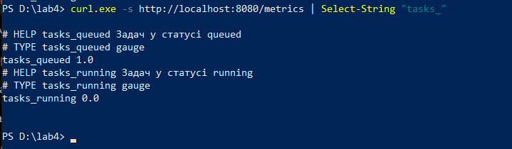

*Рисунок 14 – /metrics: tasks_queued = 1.0, tasks_running = 0.0 – відповідає стану бази (одна задача в черзі).*

## Крок 2. Воркер, його розгортання і створення задач

### 2.1. Воркер

Воркер (worker/worker.py) — окремий процес зі своїм образом. Кожен воркер обробляє одну задачу, а паралелізм визначається кількістю подів W. Ітерація складається з чотирьох етапів:

1\. Claim. Атомарний UPDATE із FOR UPDATE SKIP LOCKED захоплює найстарішу задачу зі статусом queued, змінює статус на running і збільшує token та attempts. Якщо черга порожня, воркер чекає 100 мс.

2\. Fetch. Воркер отримує дані через GET {WEB_URL}/lab-results/{record_id} від сервісу web.

3\. Process. За seed генерується зріз 256 × 256 лінійним конгруентним генератором. За гістограмою з 4096 рівнів визначаються межі p_lo і p_hi, пікселі поза ними відсікаються, решта нормалізується до діапазону 0–4095. Обчислюються межі, кількість вилучених пікселів, середнє та стандартне відхилення. Усі обчислення виконуються циклами Python без NumPy.

4\. Store. В одній транзакції записується результат у task_results і задача переводиться в done за умови збігу token. Якщо оновлено 0 рядків, транзакція відкочується, а задача позначається як lost. До кроку 5 дубль результату блокується первинним ключем. FAIL_RATE уже реалізований: із заданою ймовірністю воркер завершується через os._exit(1) після обробки, але до запису результату.

Параметри конфігурації. Адреса БД, WEB_URL, LEASE_SECONDS = 10, POLL_INTERVAL_MS = 100 і FAIL_RATE = 0 передаються через ConfigMap worker-config. Ім'я БД, користувач і пароль — через Secret db-secret. Пароль не зберігається в образі, ConfigMap чи репозиторії. WORKER_ID отримується з імені пода через Downward API.

Таблиця 3 – Метрики воркера (порт 9100)

| Метрика                      | Тип        | Мітки і зміст                                            |
|------------------------------|------------|----------------------------------------------------------|
| worker_tasks_total           | лічильник  | result: done, failed, lost – завершені задачі            |
| worker_claims_total          | лічильник  | result: task, empty – спроби захоплення                  |
| worker_task_duration_seconds | гістограма | step: claim, fetch, process, store – тривалість кроку, с |
| worker_tasks_in_flight       | вимірювач  | задач в обробці зараз                                    |

### 2.2. Образ і розгортання

Образ воркера багатоетапний: builder встановлює залежності у віртуальне середовище та видаляє pip, а фінальний python:3.12-slim містить лише середовище й worker.py. CMD задано в exec-формі.У deploy.ps1 додано збірку образу, завантаження в kind і перезапуск deployment/worker. Deployment worker (без фіксованої кількості реплік) має requests.cpu = 250m, limits.cpu = 500m, limits.memory = 512Mi та terminationGracePeriodSeconds = 30. PodMonitor збирає метрики з /metrics кожні 5 с.

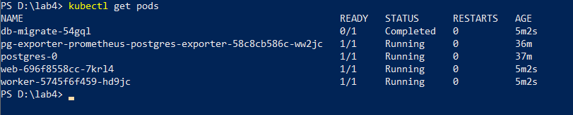

*Рисунок 15 – Pod worker-... у стані Running 1/1 разом із web, postgres-0, pg-exporter.*

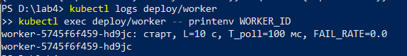

*Рисунок 16 – Журнал запуску: L = 10 с, T_poll = 100 мс, FAIL_RATE = 0.0; WORKER_ID збігається з імʼям пода.*

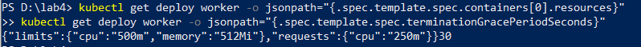

*Рисунок 17 – Ресурси: limits cpu 500m, memory 512Mi; requests cpu 250m; terminationGracePeriodSeconds = 30.*

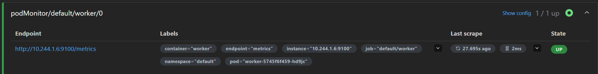

*Рисунок 18 – Prometheus Targets: podMonitor/default/worker/0 – 1/1 up, State UP.*

### 2.3. Генератор задач і виконання 20 задач

Генератор loadgen/taskload.py працює у відкритому контурі: час відправки запитів планується наперед за заданою інтенсивністю, а відправку виконує пул потоків. Кожен запит створює задачу через POST /lab-results/{id}/tasks для одного зі 100 записів. ID створених задач зберігаються у results/tasks/<мітка>.csv. Запуск: python loadgen\taskload.py --url http://localhost:8080 --rate 10 --count 20

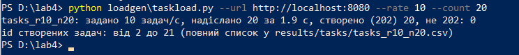

*Рисунок 19 – Створення 20 задач (10/с): надіслано за 1,9 с (швидкість дотримано), 20 створено (202), не 202 – 0; id 2–21 (задача 1 була тестовою на кроці 1, а лічильник id не скидається).*

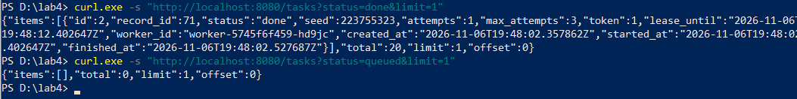

*Рисунок 20 – Усі 20 задач виконано: done – total 20, queued – total 0. У показаній задачі attempts = 1, token = 1, lease_until на 10 с пізніше за started_at (L = 10 с).*

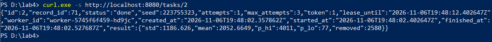

*Рисунок 21 – Результат задачі 2: p_lo = 77, p_hi = 4011, removed = 2580, mean = 2052,66, std = 1186,63. Правдоподібно: 2 % і 98 % від 4095 ≈ 82 і 4013, вилучено ≈ 4 % (≈ 2620), std ≈ 4095/√12 ≈ 1182.*

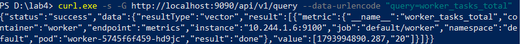

*Рисунок 22 – worker_tasks_total{result="done"} = 20.*

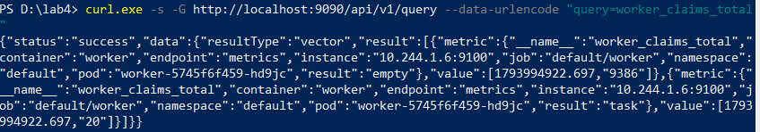

*Рисунок 23 – worker_claims_total: task = 20 (по одному захопленню на задачу, повторних немає); empty = 9386 – порожні опитування черги кожні 100 мс.*

### 2.4. Вимірювання t_io і t_cpu

Середня тривалість кроку – відношення суми до кількості спостережень гістограми (_sum / _count) за 20 задач; t_io = fetch + store, t_cpu = process.

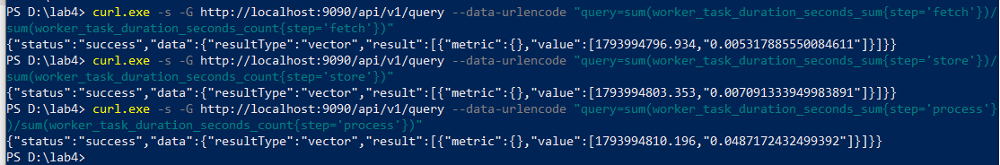

*Рисунок 24 – Середня тривалість кроків: fetch 0,005318 с, store 0,007091 с, process 0,048717 с.*

Таблиця 4 – Середня тривалість кроків

| Величина                 | Значення, с                    | Значення, мс |
|--------------------------|--------------------------------|--------------|
| t_io = t_fetch + t_store | 0,005318 + 0,007091 = 0,012409 | 12,41        |
| t_cpu (крок process)     | 0,048717                       | 48,72        |

Оцінка пропускної здатності одного воркера: 1 / (t_io + t_cpu + T_poll / 2) = 1 / (0,012409 + 0,048717 + 0,05) ≈ 9,0 задач/с; її порівняємо з виміряною X(1) на кроці 6.

**Висновок.** Воркер працює з параметрами варіанта, виконав усі 20 задач по одному разу (attempts = 1); t_io ≈ 12,4 мс, t_cpu ≈ 48,7 мс.

## Крок 3. Наївне захоплення задач і частка дублів

### 3.1. Що змінено

У режимі CLAIM_MODE=naive воркер захоплює задачу двома окремими командами в autocommit: спочатку SELECT, потім UPDATE без транзакції, FOR UPDATE та перевірки status = 'queued'. Тому два воркери можуть одночасно вибрати одну задачу.

Результат записується звичайним INSERT, а завершення — через UPDATE без перевірки токена. Кожне виконання фіксується в журналі як DONE task=<id> worker=<ім’я>.

Для перевірки дублювання первинний ключ task_results_pkey тимчасово замінено звичайним індексом idx_task_results_task_id, щоб БД дозволяла записувати кілька результатів для однієї задачі.

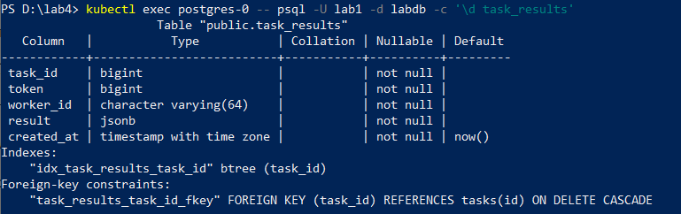

*Рисунок 25 – \d task_results: первинного ключа немає, замість нього індекс idx_task_results_task_id.*

### 3.2. Серія з T_poll = 100 мс (за варіантом)

Запущено 4 воркери в режимі naive, таблиці очищено, створено 300 задач з інтенсивністю 100 за секунду і дочекано порожньої черги. D визначено двома способами: за таблицею результатів (задачі з кількома рядками в task_results) і за журналами воркерів (задачі з кількома рядками DONE).

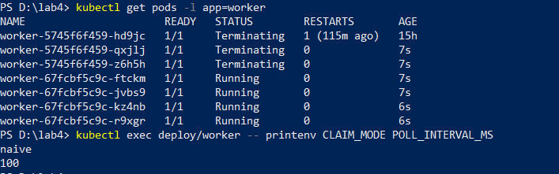

*Рисунок 26 – 4 воркери Running (старі поди Terminating після перезапуску), CLAIM_MODE = naive, POLL_INTERVAL_MS = 100.*

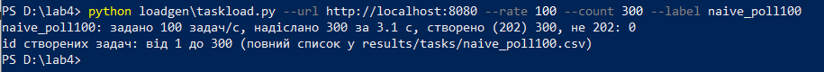

*Рисунок 27 – Створення 300 задач (100/с): надіслано за 3,1 с, усі 300 прийняті (202), не 202 – 0, id 1–300.*

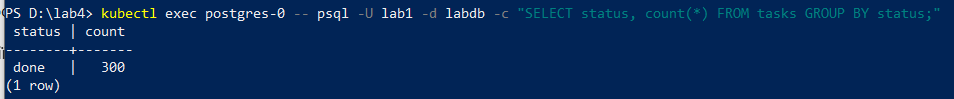

*Рисунок 28 – Черга спорожніла: усі 300 задач у статусі done.*

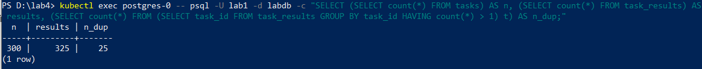

*Рисунок 29 – За таблицею: n = 300, рядків у task_results = 325, задач з кількома результатами n_dup = 25.*

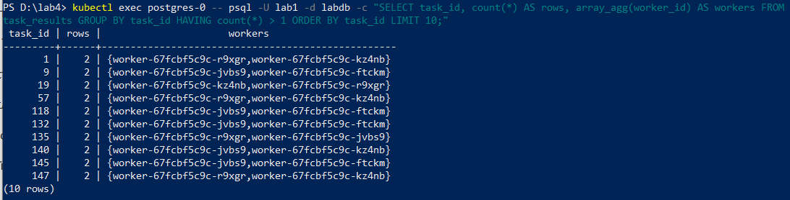

*Рисунок 30 – Приклади дублів: у кожної з наведених задач два результати від двох різних воркерів.*

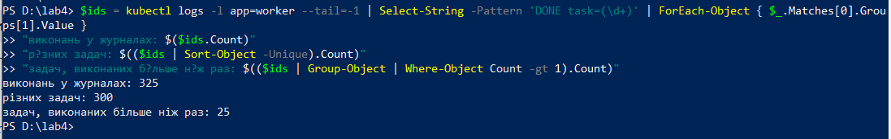

*Рисунок 31 – За журналами: 325 виконань, 300 різних задач, 25 задач виконано більше ніж раз (збігається з таблицею).*

### 3.3. Серія з T_poll = 1 мс

Інтервал опитування змінено на 1 мс (kubectl set env deployment/worker POLL_INTERVAL_MS=1), таблиці очищено (TRUNCATE tasks, task_results RESTART IDENTITY), серію повторено.

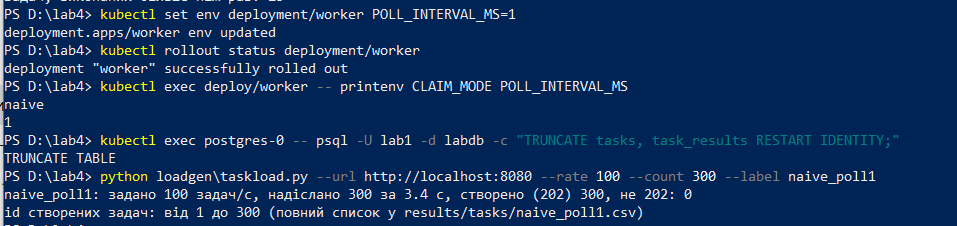

*Рисунок 32 – CLAIM_MODE = naive, POLL_INTERVAL_MS = 1; таблиці очищено, створено 300 задач за 3,4 с (202 – 300, не 202 – 0).*

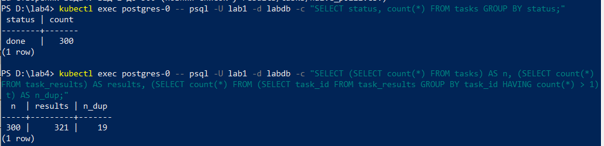

*Рисунок 33 – Усі 300 задач у статусі done; за таблицею n = 300, рядків результатів 321, n_dup = 19.*

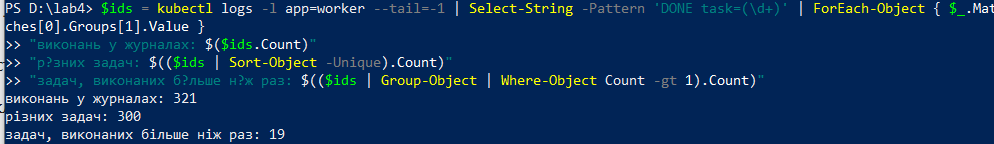

*Рисунок 34 – За журналами: 321 виконання, 300 різних задач, 19 задач виконано більше ніж раз.*

Таблиця 5 – Частка дублів D при наївному захопленні (4 воркери, 300 задач)

| T_poll, мс | n   | Рядків у task_results | n_dup за таблицею | D за таблицею          | n_dup за журналами | D за журналами         |
|------------|-----|-----------------------|-------------------|------------------------|--------------------|------------------------|
| 100        | 300 | 325                   | 25                | 25/300 = 0,083 (8,3 %) | 25                 | 25/300 = 0,083 (8,3 %) |
| 1          | 300 | 321                   | 19                | 19/300 = 0,063 (6,3 %) | 19                 | 19/300 = 0,063 (6,3 %) |

### 3.4. Аналіз

В обох серіях виявлено дублікати: 6,3 % при T_poll = 1 мс і 8,3 % при T_poll = 100 мс. Кожна дубльована задача оброблена рівно двома воркерами. Кількість результатів збігається з журналами: 325 = 300 + 25 та 321 = 300 + 19.

Очікувана залежність від T_poll не підтвердилася. Різниця невелика (19 проти 25 задач), а через лише один прогін на кожен інтервал її не можна вважати статистично значущою. Ймовірна причина — черга постійно залишається непорожньою: чотири воркери обробляють близько 65 задач/с, тоді як надходить 100 задач/с. Тому очікування після порожнього захоплення майже не виникає. Це припущення, оскільки довжина черги не вимірювалася.

Висновок. Наївне захоплення спричиняє дублювання 6–8 % задач і зайві обчислення. Для усунення проблеми на кроці 4 використовується атомарне захоплення через FOR UPDATE SKIP LOCKED та відновлюється первинний ключ task_results, який не дозволяє зберігати дублікати.

## Крок 4. Захоплення задачі однією командою: FOR UPDATE SKIP LOCKED

### 4.1. Що змінено

Задача захоплюється однією командою UPDATE з SELECT ... FOR UPDATE. SKIP LOCKED дозволяє пропускати заблоковані рядки. Для порівняння режим CLAIM_MODE=for_update працює без SKIP LOCKED. Запис CLAIM у журналі дозволяє визначити дублювання D, оскільки первинний ключ блокує повторний запис результату.

Вимірювання. Скрипт step4_probe.py очищає таблиці, знімає початкові метрики, створює 300 задач зі швидкістю 100/с, чекає спорожнення черги та знімає метрики повторно. Щосекунди фіксується максимум запитів, що очікують блокування. Також вимірюються p99 часу захоплення за гістограмою worker_task_duration_seconds і кількість порожніх захоплень за worker_claims_total.

### 4.2. Повернення первинного ключа

Таблицю результатів очищено (дублі кроку 3 не дали б створити ключ), тимчасовий індекс видалено і додано первинний ключ: TRUNCATE tasks, task_results RESTART IDENTITY; DROP INDEX idx_task_results_task_id; ALTER TABLE task_results ADD PRIMARY KEY (task_id);

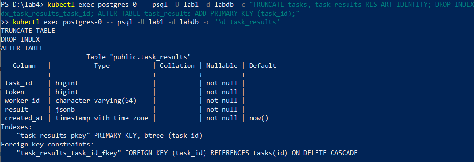

*Рисунок 35 – Первинний ключ повернуто: у task_results є task_results_pkey за task_id, тимчасового індексу немає.*

### 4.3. Серія з FOR UPDATE SKIP LOCKED (T_poll = 1 мс)

Воркери переведено в режим skip_locked з T_poll = 1 мс командою kubectl set env deployment/worker CLAIM_MODE=skip_locked POLL_INTERVAL_MS=1 і виконано серію python scripts\step4_probe.py run --label skip_poll1.

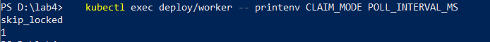

*Рисунок 36 – Перед серією: CLAIM_MODE = skip_locked, POLL_INTERVAL_MS = 1.*

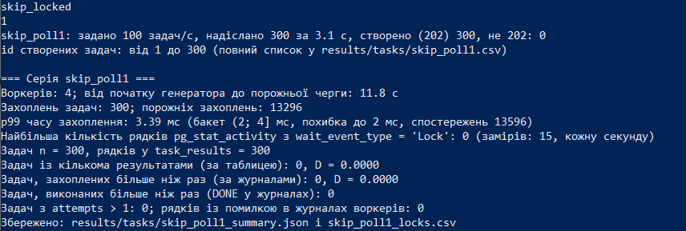

*Рисунок 37 – Серія skip_poll1: 300 задач створено (202), захоплень задач 300, порожніх 13296, p99 часу захоплення 3,39 мс, рядків Lock 0, у task_results 300 рядків, D = 0 за таблицею й за журналами.*

### 4.4. Серія з FOR UPDATE без SKIP LOCKED (T_poll = 1 мс)

Режим змінено на for_update командою kubectl set env deployment/worker CLAIM_MODE=for_update і виконано серію python scripts\step4_probe.py run --label forupdate_poll1.

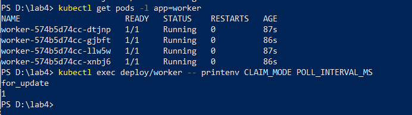

*Рисунок 38 – 4 воркери Running, CLAIM_MODE = for_update, POLL_INTERVAL_MS = 1.*

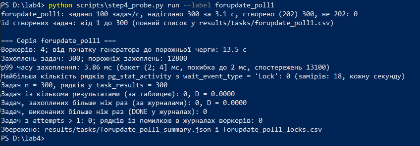

*Рисунок 39 – Серія forupdate_poll1: 300 задач створено, захоплень задач 300, у task_results 300 рядків, D = 0 за таблицею й за журналами.*

Таблиця 6 – Частка дублів D за способами захоплення (4 воркери, 300 задач)

| Захоплення                 | T_poll, мс | D за таблицею | D за журналами |
|----------------------------|------------|---------------|----------------|
| наївне (SELECT + UPDATE)   | 100        | 0,083         | 0,083          |
| наївне (SELECT + UPDATE)   | 1          | 0,063         | 0,063          |
| FOR UPDATE SKIP LOCKED     | 1          | 0             | 0              |
| FOR UPDATE без SKIP LOCKED | 1          | 0             | 0              |

Таблиця 7 – Порівняння SKIP LOCKED і FOR UPDATE (T_poll = 1 мс, 300 задач)

| Показник                                                              | FOR UPDATE SKIP LOCKED | FOR UPDATE     |
|-----------------------------------------------------------------------|------------------------|----------------|
| Рядків у task_results (задач n = 300)                                 | 300                    | 300            |
| D за таблицею / за журналами                                          | 0 / 0                  | 0 / 0          |
| Задач з attempts > 1                                                 | 0                      | 0              |
| p99 часу захоплення (бакет (2; 4\] мс, похибка до 2 мс)               | 3,39 мс                | 3,86 мс        |
| Порожніх захоплень (за worker_claims_total)                           | 13296                  | 12800          |
| Захоплень задач                                                       | 300                    | 300            |
| Найбільша кількість рядків Lock у pg_stat_activity (заміри щосекунди) | 0 (15 замірів)         | 0 (18 замірів) |

### 4.5. Повернення налаштувань варіанта

Перевизначення CLAIM_MODE і POLL_INTERVAL_MS у Deployment видалено командою kubectl set env deployment/worker CLAIM_MODE- POLL_INTERVAL_MS-; інтервал знову береться з ConfigMap worker-config.

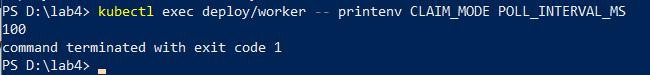

*Рисунок 40 – Налаштування варіанта повернуто: POLL_INTERVAL_MS = 100 (T_poll за варіантом); режим захоплення – skip_locked (значення за замовчуванням).*

### 4.6. Аналіз

Дублі усунено. В обох серіях D = 0: усі 300 задач мають по одному результату, attempts не перевищує 1. SKIP LOCKED дозволяє другому воркеру взяти наступну вільну задачу, а звичайний FOR UPDATE змушує його чекати звільнення блокування. Обидва варіанти усувають дублювання.

Помітної різниці в часі захоплення немає: p99 становить 3,39 мс і 3,86 мс відповідно, що потрапляє в один бакет гістограми. Кількість порожніх захоплень також близька: 13296 і 12800. Переважно це холості опитування порожньої черги з інтервалом 1 мс. Очікувань блокувань у вимірюваннях не зафіксовано, оскільки вони тривають дуже коротко, а перевірка виконується раз на секунду.

Висновок. FOR UPDATE SKIP LOCKED усуває дублювання (D = 0 проти 6–8 % у наївному режимі) та дозволяє не чекати заблокованих рядків. Для наступних кроків використовується цей режим із T_poll = 100 мс.

## Крок 5. Lease, heartbeat, fencing token і ідемпотентний запис результату

### 5.1. Що реалізовано

Lease і heartbeat. Під час захоплення встановлюється lease_until = now() + L. Окремий потік воркера кожні 3,33 с продовжує lease за id і token. Якщо оновлено 0 рядків, воркер втратив право на задачу, про що записується повідомлення в журнал.

Повернення задач. Фоновий потік web кожні 5 с перевіряє прострочені lease: задачі повертаються в queued, а після трьох спроб (max_attempts = 3) переходять у failed.

Збереження результату. В одній транзакції задача переводиться в done із перевіркою token, після чого результат записується через INSERT ... ON CONFLICT (task_id) DO NOTHING. Якщо UPDATE не змінив рядок, результат не записується.

```sql
UPDATE tasks SET lease_until = now() + make_interval(secs => 10)
WHERE id = %s AND token = %s;

UPDATE tasks
SET status = CASE WHEN attempts >= max_attempts THEN 'failed' ELSE 'queued' END,
    worker_id = NULL,
    finished_at = CASE WHEN attempts >= max_attempts THEN now() ELSE finished_at END
WHERE status = 'running' AND lease_until < now();

UPDATE tasks SET status = 'done', finished_at = now()
WHERE id = %s AND token = %s;

INSERT INTO task_results (task_id, token, worker_id, result)
VALUES (%s, %s, %s, %s)
ON CONFLICT (task_id) DO NOTHING;
```

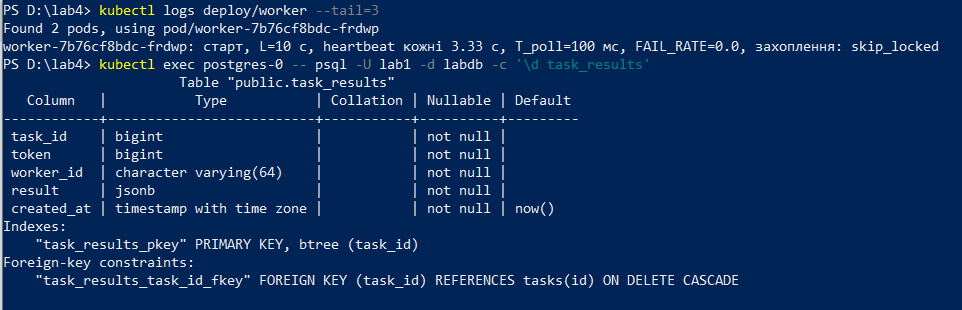

*Рисунок 41 – Воркер запущено з L = 10 с і heartbeat кожні 3,33 с; у task_results є первинний ключ за task_id.*

### 5.2. Повернення в чергу і перехід у failed

Для перевірки в чергу вставлено дві «покинуті» задачі зі спливлим lease: задачу 1 з attempts = 3 (= max_attempts) і задачу 2 з attempts = 1.

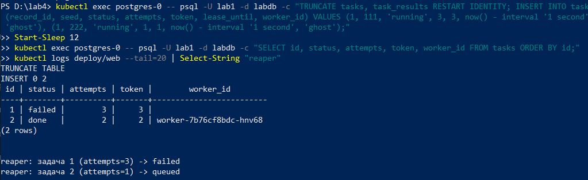

*Рисунок 42 – Задача 1 стала failed (attempts = 3); задача 2 повернена в чергу й виконана воркером ...hnv68 (done, attempts = 2, token = 2). Журнал web: «reaper: задача 1 (attempts=3) -> failed» і «reaper: задача 2 (attempts=1) -> queued».*

### 5.3. Зупинка воркера на 2 · L секунд під час обробки 100 задач

Скрипт scripts/step5_probe.py створює 100 задач зі швидкістю 100/с на двох воркерах, чекає захоплення задачі воркером ...frdwp, зупиняє його на 20 с (2 × L) і відновлює.

Зупинка через os.kill(1, SIGSTOP) усередині контейнера не спрацювала. Тому процес PID 1 зупинили з вузла кластера командою docker exec lab3-worker2 kill -STOP <PID>, після чого його стан став T. Для відновлення використали kill -CONT.

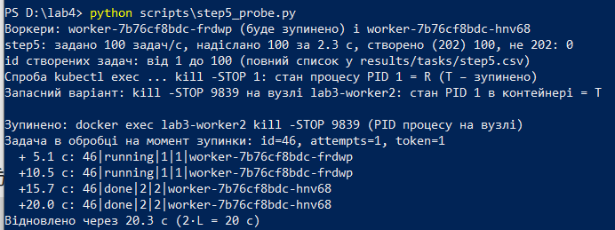

*Рисунок 43 – Зупинка: задача 46 була в обробці (attempts = 1, token = 1) і лишалась running на +5,1 і +10,5 с; на +15,7 с вона вже done (attempts = 2, token = 2) у воркера ...hnv68; воркер відновлено через 20,3 с.*

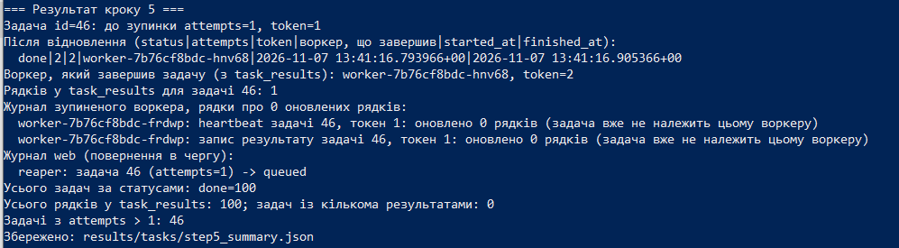

*Рисунок 44 – Підсумок випробування: задача 46 завершена іншим воркером, у task_results для неї 1 рядок; зупинений воркер після відновлення отримав 0 оновлених рядків.*

Таблиця 8 – Результат зупинки воркера (задача 46)

| Показник                                                | Значення                                                                                                |
|---------------------------------------------------------|---------------------------------------------------------------------------------------------------------|
| Задача в обробці на момент зупинки                      | id = 46                                                                                                 |
| attempts і token до зупинки                             | 1 і 1                                                                                                   |
| attempts і token після відновлення                      | 2 і 2                                                                                                   |
| Воркер, який завершив задачу                            | worker-7b76cf8bdc-hnv68 (зупинений – worker-7b76cf8bdc-frdwp)                                           |
| Рядки журналу зупиненого воркера про 0 оновлених рядків | heartbeat задачі 46, токен 1: оновлено 0 рядків; запис результату задачі 46, токен 1: оновлено 0 рядків |
| Повернення в чергу (журнал web)                         | reaper: задача 46 (attempts=1) -> queued                                                               |
| Рядків у task_results для задачі 46                     | 1                                                                                                       |
| Усі 100 задач                                           | done = 100; рядків у task_results 100; задач з кількома результатами 0                                  |

**Висновок.** Після спливання lease web повернув задачу в чергу, і її виконав другий воркер (токен 1 → 2). Коли зупинений воркер ожив, його команди зі старим токеном 1 змінили 0 рядків, тому він не продовжив lease і не записав другий результат: fencing token працює, а результат задачі записано один раз.

## Крок 6. Пропускна здатність пулу воркерів X(W)

Мета. Виміряти пропускну здатність пулу для W = 1, 2 і 4 воркерів та підібрати параметри універсального закону масштабованості. Перед кожним прогоном одним SQL-запитом додається 400 задач, щоб черга була непорожньою. X(W) — середня кількість завершених задач за секунду, розкид — стандартне відхилення посекундних значень.Через швидке спорожнення черги замість 30 с використано весь інтервал обробки: 27, 14 і 8 с відповідно. Додатково вимірюються p99 часу захоплення, кількість транзакцій БД (pg_stat_database) та CPU пода БД (cgroup). Запуск: python scripts\step6_run.py W; python scripts\step6_fit.py

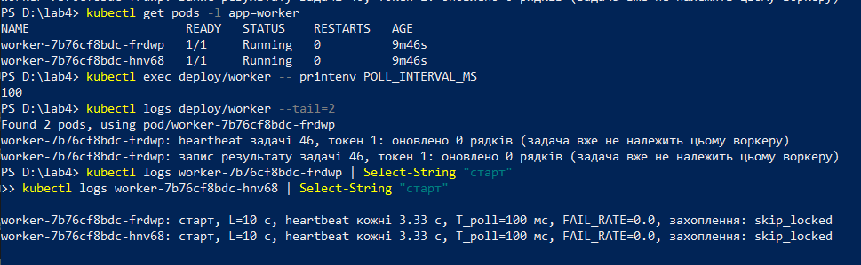

*Рисунок 45 – Стан перед серією: воркери Running (RESTARTS = 0), POLL_INTERVAL_MS = 100, у журналах «старт ... T_poll=100 мс ... skip_locked».*

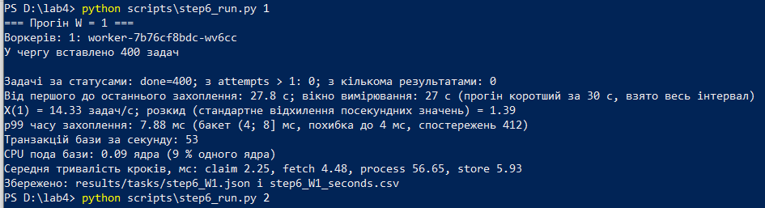

*Рисунок 46 – Прогін W = 1: X(1) = 14,33 задач/с, розкид 1,39, p99 захоплення 7,88 мс, 53 транзакції/с, CPU бази 0,09 ядра.*

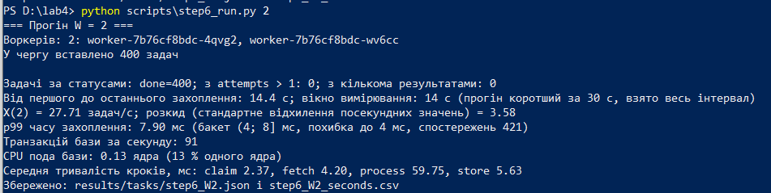

*Рисунок 47 – Прогін W = 2: X(2) = 27,71 задач/с, розкид 3,58, p99 захоплення 7,90 мс, 91 транзакція/с, CPU бази 0,13 ядра.*

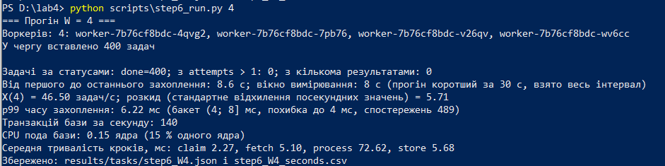

*Рисунок 48 – Прогін W = 4: X(4) = 46,50 задач/с, розкид 5,71, p99 захоплення 6,22 мс, 140 транзакцій/с, CPU бази 0,15 ядра.*

Таблиця 9 – Пропускна здатність пулу воркерів (400 задач у черзі)

| W   | X(W), задач/с | Розкид | C(W)  | p99 захоплення            | Транзакцій/с | CPU бази, ядра | Вікно, с |
|-----|---------------|--------|-------|---------------------------|--------------|----------------|----------|
| 1   | 14,33         | 1,39   | 1,000 | 7,88 мс, бакет (4; 8\] мс | 53           | 0,09           | 27       |
| 2   | 27,71         | 3,58   | 1,934 | 7,90 мс, бакет (4; 8\] мс | 91           | 0,13           | 14       |
| 4   | 46,50         | 5,71   | 3,244 | 6,22 мс, бакет (4; 8\] мс | 140          | 0,15           | 8        |

Таблиця 10 – Середня тривалість кроків задачі, мс

| W   | claim | fetch | process | store |
|-----|-------|-------|---------|-------|
| 1   | 2,25  | 4,48  | 56,65   | 5,93  |
| 2   | 2,37  | 4,20  | 59,75   | 5,63  |
| 4   | 2,27  | 5,10  | 72,62   | 5,68  |

**Закон масштабованості.** Оцінки за формулами лабораторної роботи 2 (за точками W = 2 і 4): σ = −0,0089, κ = 0,02165. Оцінка σ відʼємна, тому за правилом із завдання σ = 0, а κ перераховано за однопараметричною формулою: σ = 0, κ = 0,01935, W* = √((1 − σ) / κ) = 7,19.

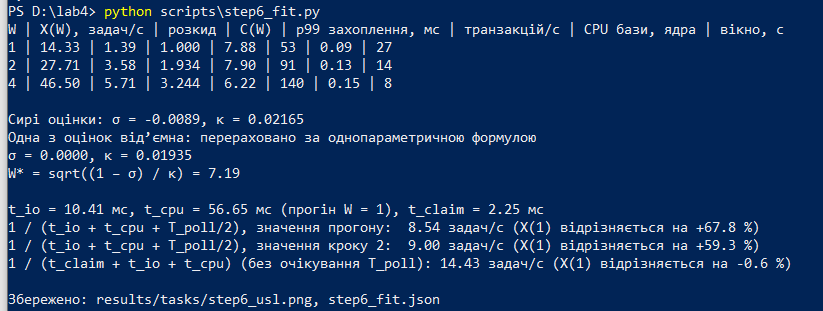

*Рисунок 49 – Розрахунок step6_fit.py: C(W), σ, κ, W* і порівняння X(1) з оцінкою за часом кроків.*

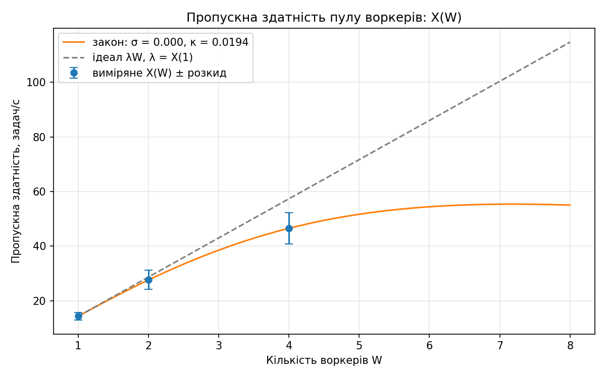

*Рисунок 50 – X(W) з розкидом (точки), крива закону з σ = 0 і κ = 0,0194 та пряма ідеалу λW, λ = X(1). Праворуч від W = 4 крива є екстраполяцією.*

**Порівняння X(1) з оцінкою.** За виміряними t_io = 10,41 мс і t_cpu = 56,65 мс теоретична пропускна здатність 8,54 задач/с (за даними кроку 2 — 9,00), тоді як фактична X(1) = 14,33 задач/с. Різниця пояснюється тим, що за непорожньої черги воркер одразу бере наступну задачу, не очікуючи T_poll / 2. Якщо не враховувати це очікування, оцінка становить 14,43 задач/с, що майже збігається з результатом вимірювання (різниця −0,6 %).

**Висновок.** Масштабування майже лінійне: ефективність для W = 1, 2, 4 становить 100 %, 97 % і 81 %. Послідовної частки не виявлено (σ = 0), а накладні витрати описує κ = 0,0194. Час обробки задачі зростає з 56,7 до 72,6 мс (+28 %), тоді як навантаження на CPU бази залишається низьким (0,09–0,15 ядра). Імовірне обмеження — процесор ноутбука, на якому одночасно працюють воркери, база та кластер, але окремо це не перевіряли. Значення W* = 7,2 є екстраполяцією за межі перевіреного діапазону (W ≤ 4).

## Крок 7. Закон Літтла для черги: сталий режим і перевантаження

Перевірка закону Літтла L_q = λ · W_q для черги у стабільному режимі та під час перевантаження. Прогони виконано на 4 воркерах із продуктивністю X(4) = 46,50 задач/с (крок 6). λ – кількість створених задач за секунду, L_q – середня кількість задач у черзі за метрикою Prometheus, W_q – середній час очікування задач. Додатково L_q перевірено за даними таблиці tasks. Команди: python scripts\step7_run.py stable і python scripts\step7_run.py overload.


*Рисунок 51 – Перед прогонами: 4 воркери Running, RESTARTS = 0 у нових подів; воркери виконують задачі.*


*Рисунок 52 – Метрика tasks_queued доступна в Prometheus (значення 0 у порожній черзі).*

### 7.1. Сталий режим: 0,7 · X(4) = 32,55 задач/с, 180 с

Вікно вимірювання – останні 120 с до останньої створеної задачі.


*Рисунок 53 – Сталий режим: створено 5858 задач (усі 202), усі done, attempts > 1 і дублів немає; блок результату наведено в таблиці 11.*

Таблиця 11 – Закон Літтла у сталому режимі (вікно 120 с)

| Величина                                | Значення                                              |
|-----------------------------------------|-------------------------------------------------------|
| λ, задач/с                              | 32,54 (створено у вікні 3905)                         |
| W_q                                     | 20,8 мс (перша половина вікна 20,1 мс, друга 21,6 мс) |
| λ · W_q                                 | 0,6782                                                |
| L_q – середнє tasks_queued (Prometheus) | 0,6667; розбіжність 1,7 %                             |
| L_q – точне за таблицею tasks           | 0,6785; розбіжність 0,0 %                             |


*Рисунок 54 – Довжина черги у сталому режимі; оранжева ділянка – вікно вимірювання 120 с, пунктир – кінець створення задач.*

Черга лишається короткою (0–2 задачі у вікні), W_q однакова в обох половинах вікна, тож режим сталий, а виміряне L_q збігається з λ · W_q (розбіжність 1,7 % за метрикою). Метрика tasks_queued оновлюється раз на 5 с, тому дає грубішу вибірку, ніж таблиця. Збіг точного L_q з λ · W_q є очікуваним, бо обидві величини обчислені з тих самих рядків.

### 7.2. Перевантаження: 1,3 · X(4) = 60,45 задач/с, 120 с


*Рисунок 55 – Перевантаження: довжина черги на кінець прогону, швидкість виконання і W_q за першими й останніми 100 задачами.*

Таблиця 12 – Перевантаження

| Величина                                      | Значення                                          |
|-----------------------------------------------|---------------------------------------------------|
| Задано / фактична інтенсивність створення     | 60,45 / 61,50 задач/с (7253 задачі створено, 202) |
| Швидкість виконання під час прогону           | 44,76 задач/с (X(4) зі кроку 6 = 46,50)           |
| Довжина черги на кінець прогону (за таблицею) | 1952 (у Prometheus одразу після генератора 1913)  |
| Очікувана (λ − X) · T за виміряною швидкістю  | (61,50 − 44,76) · 117,9 ≈ 1974                    |
| W_q за першими 100 задачами                   | 0,952 с                                           |
| W_q за останніми 100 задачами                 | 42,170 с (оцінка: довжина черги / X(4) = 42,0 с)  |


*Рисунок 56 – Довжина черги під перевантаженням: майже лінійне зростання до ≈ 1950 задач за 120 с створення, далі спадання до нуля.*

Інтенсивність створення (61,5 задач/с) перевищує швидкість виконання (44,8 задач/с), тому черга зростає приблизно на 16,7 задач/с. Час очікування збільшується від 0,95 с до 42 с. Один із 7254 запитів не отримав статусу 202, тому в таблиці 7253 задачі. Закон Літтла не виконується, оскільки сталого режиму немає.

## Крок 8. Коректна зупинка воркера за SIGTERM

### 8.1. Поведінка до реалізації обробника

Без обробника SIGTERM процес Python (PID 1) не завершується коректно. Після 30 с Kubernetes надсилає SIGKILL (код 137), а задачі залишаються running до завершення lease.


*Рисунок 57 – Перезапуск без обробника SIGTERM: усі 4 старі контейнери завершились з кодом 137, рядків STOP немає; failed = 0, дублів немає; 1 задача (id 1557) має attempts > 1.*


*Рисунок 58 – Задача 1557, що була в обробці в момент SIGKILL: повернена за lease і виконана іншим воркером (done, attempts = 2, token = 2).*

### 8.2. Реалізація

Обробник SIGTERM виставляє прапорець зупинки: воркер припиняє брати нові задачі, завершує поточну і виходить з кодом 0. Запобіжник: якщо за STOP_GRACE_SECONDS = 25 с задача не завершена, вона повертається в чергу через UPDATE лише за умови status = 'running', після чого воркер завершується з кодом 0. Exec-форма CMD у Dockerfile забезпечує передачу сигналу безпосередньо воркеру.


*Рисунок 59 – Новий воркер: 4 поди Running; у журналі «старт ... ліміт на зупинку 25 с».*

### 8.3. Прогін зі штатним лімітом


*Рисунок 60 – Коректна зупинка під потоком 0,7 · X(4): усі 4 старі контейнери завершились з кодом 0 (Completed), у кожному по одному рядку STOP; повернуто 0, failed = 0, задач з кількома результатами 0, attempts > 1: 0; усі 1952 задачі done.*

### 8.4. Перевірка гілки повернення задачі

Штатно задача обробляється ≈ 60–80 мс і завершується до ліміту, тому гілка повернення не спрацьовує. Щоб її перевірити, ліміт зменшено до 0,02 с (STOP_GRACE_SECONDS=0.02), а в чергу вставлено 1500 задач, щоб воркери були зайняті в момент SIGTERM.


*Рисунок 61 – Ліміт на зупинку на час перевірки: STOP_GRACE_SECONDS = 0.02.*


*Рисунок 62 – Перевірка повернення: усі 4 контейнери завершились з кодом 0; воркер повернув у чергу задачу 128 (RETURNED = 1), її виконав інший воркер (done, attempts = 2, token = 2), у task_results для неї 1 рядок; failed = 0, дублів немає.*

Таблиця 13 – Результати зупинки воркерів

| Прогін                              | Коди завершення | Повернуто в чергу | failed | Задач з кількома результатами | Задач з attempts > 1 |
|-------------------------------------|-----------------|-------------------|--------|-------------------------------|-----------------------|
| Без обробника SIGTERM               | 137 × 4         | 0                 | 0      | 0                             | 1 (id 1557)           |
| Коректна зупинка (ліміт 25 с)       | 0 × 4           | 0                 | 0      | 0                             | 0                     |
| Перевірка повернення (ліміт 0,02 с) | 0 × 4           | 1 (id 128)        | 0      | 0                             | 1 (id 128)            |

**Висновок.** З обробником SIGTERM воркери зупиняються з кодом 0 без жодної втраченої задачі; повернена воркером задача виконується повторно іншим воркером і не стає дублем, бо результат записано один раз.

## Крок 9. Падіння воркерів (FAIL_RATE = 0,15) і сценарій відмови Ф2

Мета – перевірити роботу пулу за аварійних падінь воркерів. Задано FAIL_RATE=0.15: воркер із імовірністю 15% аварійно завершується до запису результату. Прогін: 4 воркери, 32,55 задач/с протягом 300 с (9765 задач), скрипт step9_run.py. Сесії БД прив’язані до імен подів. Очікувана кількість захоплень до успіху – 1,18, частка повторних спроб – 15%, частка failed після трьох невдалих спроб – 0,34%.


*Рисунок 63 – Перед прогоном: 4 воркери Running, RESTARTS = 0, FAIL_RATE = 0.15 у Deployment.*


*Рисунок 64 – Сесії бази воркерів підписано іменами подів (application_name): по одній сесії на воркер.*


*Рисунок 65 – Хід прогону: стан подів кожні 30 с (число перезапусків і стан), момент сценарію Ф2 і стан подів після прогону – усі 4 поди у CrashLoopBackOff з 5 перезапусками.*

Кожен воркер падає приблизно після 6–7 захоплень; Kubernetes перезапускає контейнер, але з наростаючою паузою між перезапусками (CrashLoopBackOff). Тому за 300 с кожен под перезапустився лише 5 разів, а воркери більшу частину часу не працюють. Скрипт не чекає спорожнення черги: збір даних завершується через 20 с після кінця створення задач.


*Рисунок 66 – Результат прогону: перезапуски, розподіл задач за attempts, частки attempts > 1 і failed, задачі з кількома результатами, X.*

Таблиця 14 – Розподіл задач за attempts (9765 задач)

| attempts | Усі задачі | Завершені (done, failed) | Частка серед завершених | За моделлю (f = 0,15) |
|----------|------------|--------------------------|-------------------------|-----------------------|
| 0        | 9626       | 0                        | –                       | –                     |
| 1        | 119        | 118                      | 85,51 %                 | 85,00 %               |
| 2        | 17         | 17                       | 12,32 %                 | 12,75 %               |
| 3        | 3          | 3                        | 2,17 %                  | 2,25 %                |

Таблиця 15 – Результати прогону

| Показник                                    | Значення                                                   |
|---------------------------------------------|------------------------------------------------------------|
| Перезапусків контейнерів worker (RESTARTS)  | 5, 5, 5, 5; разом 20; усі поди CrashLoopBackOff            |
| Задач за статусами                          | done = 137, failed = 1, queued = 9627                      |
| Частка attempts > 1 серед завершених       | 20 / 138 = 14,49 % (f = 15 %, очікуваний розкид ±6,0 п.п.) |
| Частка failed серед завершених              | 1 / 138 = 0,72 % (f³ = 0,34 %)                             |
| Задач з більше ніж одним результатом        | 0; рядків у task_results 137 (= done)                      |
| X: за 300 с / за останні 120 с              | 0,46 / 0,15 задач/с (λ = 32,55; X(4) без падінь = 46,50)   |
| Завершено задач/с по 30-секундних відрізках | 2,0; 1,4; 0,0; 0,5; 0,0; 0,0; 0,6; 0,0; 0,0; 0,0           |

Розподіл задач за attempts близький до моделі (85,5 / 12,3 / 2,2 % проти 85,0 / 12,75 / 2,25 %). Частка повторних спроб – 14,5 % при очікуваних 15 %. Одна failed-задача з 138 пояснюється випадковим розкидом малої вибірки. Дублів результатів немає. Продуктивність впала до 0,46 задач/с через CrashLoopBackOff воркерів, а черга зросла приблизно до 9600 задач.


*Рисунок 67 – Сценарій Ф2: сесію бази воркера ...wgfjh завершено під час задачі 122; журнал воркера, доля задачі, кількість результатів.*

Таблиця 16 – Сценарій Ф2 (pg_terminate_backend)

| Показник                                  | Значення                                                                                          |
|-------------------------------------------|---------------------------------------------------------------------------------------------------|
| Момент сценарію                           | 181-ша секунда від першої задачі                                                                  |
| Воркер і задача, що оброблялась           | worker-5979dd756c-wgfjh, задача 122 (attempts = 1, token = 1)                                     |
| Рядок журналу воркера про перепідключення | втрачено зʼєднання з базою (terminating connection due to administrator command), перепідключення |
| Повернення в чергу (reaper у web)         | через 13,1 с після відмови, статус queued                                                         |
| Повторне захоплення                       | через 14,4 с після відмови воркером worker-5979dd756c-67hl9                                       |
| Після прогону                             | status = done, attempts = 2, token = 2                                                            |
| Рядків у task_results для задачі 122      | 1 (воркер 67hl9)                                                                                  |

Після обриву сесії воркер не зміг записати результат, повідомив про втрату зʼєднання і перепідключився сам. Задача лишилась running, heartbeat припинився, lease спливло, web повернув її в чергу, і її виконав інший воркер: результат один, дубля немає.


*Рисунок 68 – Діаграма прогону: tasks_queued (зростає до ≈ 9600), tasks_running і кількість завершених задач за секунду; червона лінія – сценарій Ф2, сіра – кінець створення задач.*

## Крок 10. Додаткова вимога Д6: скасування задачі

`DELETE /tasks/{id}` переводить queued у cancelled, а для running встановлює прапорець скасування, який воркер перевіряє між етапами обробки. Оскільки k не задано, прийнято 4 блоки (CANCEL_PASSES). При скасуванні воркер припиняє обробку без запису результату та встановлює статус cancelled.

Таблиця 17 – Коди відповіді DELETE /tasks/{id}

| Стан задачі        | Дія                                                                          | Код |
|--------------------|------------------------------------------------------------------------------|-----|
| queued             | одразу cancelled                                                             | 200 |
| running            | виставляється cancel_requested і cancel_requested_at, воркер зупиняється сам | 202 |
| cancelled          | без змін (повторний запит)                                                   | 200 |
| done або failed    | задача вже завершена                                                         | 409 |
| немає такої задачі | –                                                                            | 404 |

До схеми додано поля cancel_requested і cancel_requested_at, а до CHECK для status – значення cancelled. Час запиту скасування та зупинки обробки фіксується годинником БД. Якщо воркер падає, фоновий потік переводить задачу зі скасуванням у cancelled, а не повертає її в чергу.


*Рисунок 69 – Схема після міграції: поля cancel_requested, cancel_requested_at і CHECK на status зі значенням cancelled.*


*Рисунок 70 – Після розгортання: db-migrate – Completed, web і 4 воркери Running.*


*Рисунок 71 – FAIL_RATE воркерів = 0; у журналі «старт ... проходів скасування 4».*


*Рисунок 72 – Ручна перевірка (воркерів зупинено, щоб задача лишалась у черзі): DELETE /tasks/1 для задачі в черзі → 200, status = cancelled, cancel_requested_at заповнено.*


*Рисунок 73 – DELETE /tasks/99999 → 404.*

**Вимірювання**

Скрипт step10_run.py: у чергу додано 800 задач на 4 воркерах (FAIL_RATE = 0). Скасовано 3 задачі в черзі, решту – під час обробки через GET і DELETE. Час скасування розраховано за першими 20 зупиненими задачами.


*Рисунок 74 – Скасування: задачі в черзі (800, 799, 798) → 200 cancelled; повторний запит → 200; для задач у running 202 × 25; DELETE задачі done → 409, неіснуючої → 404.*


*Рисунок 75 – Час від запиту скасування до зупинки обробки для 20 задач у running: p50 = 6,49 мс, p99 = 42,76 мс; усі 20 задач cancelled, у task_results для них 0 рядків.*


*Рисунок 76 – Час зупинки обробки після скасування (20 задач у running), лінії p50 і p99.*

Таблиця 18 – Результати скасування

| Показник                             | Значення                                             |
|--------------------------------------|------------------------------------------------------|
| p50 / p99 часу від запиту до зупинки | 6,49 мс / 42,76 мс                                   |
| min / max / середнє                  | 2,83 / 43,33 / 14,58 мс                              |
| Статус зупинених задач               | cancelled × 20                                       |
| Рядків у task_results для них        | 0                                                    |
| Скасовані в черзі (800, 799, 798)    | cancelled; рядків у task_results 0                   |
| Скасування надійшло надто пізно      | 1 задача (id 55) встигла стати done                  |
| Усього задач за статусами            | cancelled = 27, done = 773; задач з attempts > 1: 0 |

Зупинка відбувається після поточного блоку: медіана – 6,5 мс, максимум – 43 мс (обробка триває ≈ 57–73 мс). Затримки можуть бути пов’язані з обмеженням CPU та конкуренцією за ресурси. Через малу вибірку з 20 задач p99 майже дорівнює максимуму. Скасовані задачі не мають результатів, а одна завершилась зі статусом done, оскільки скасування надійшло запізно.

## Висновки

Реалізовано чергу задач у PostgreSQL з пулом воркерів. Захоплення через FOR UPDATE SKIP LOCKED усунуло дублювання задач (D = 0). Lease, heartbeat і fencing token забезпечують повернення задач після падіння воркера та захист від повторного запису. ON CONFLICT DO NOTHING гарантує один результат на задачу.

Продуктивність зростає зі збільшенням кількості воркерів: X(1) = 14,3, X(2) = 27,7, X(4) = 46,5 задач/с. У сталому режимі закон Літтла виконується з похибкою 1,7 %, а під перевантаженням черга зростає лінійно. Коректне завершення та аварійні ситуації не призводять до втрати задач. Додатково реалізовано скасування: обробка зупиняється за кілька мілісекунд (p50 = 6,5 мс, p99 = 42,8 мс) без запису результату.
